Deployment: Live at https://varshini-duriseti-lab2-bdf.vercel.app/. Verified: `/` returns HTTP 200, `/books` returns HTTP 200 with ten seeded records, and `/books/1` returns The Guide. SQLite writes on Vercel use temporary storage and are not durable.

# Lab 2 – SQLite Database and CRUD Routes

## Student details

- **Student:** DURISETI VARSHINI
- **Registration number:** 252U1R5040
- **Class / section:** CSE-AIDE-2A/106
- **Faculty:** Mr Sai Siva Teja Chintakrindi
- **Subject:** Backend Development Fundamentals
- **Academic year / term:** Year II / Term II
- **Lab:** Lab 2 – SQLite Database and CRUD Routes

> **Faculty name check:** The assignment screenshot header reportedly shows Joel Prashanth D, while the supplied student details specify Mr Sai Siva Teja Chintakrindi. Confirm the correct name before preparing the final report.

## Objective

Connect an Express server to an SQLite database and provide HTTP routes to create, read, update, and delete book records.

## Technologies

- **Node.js:** Runs the JavaScript server.
- **Express:** Defines the HTTP routes.
- **sqlite3:** Connects the Node.js application to SQLite.
- **sqlite:** Provides Promise-based database methods that work with `async/await`.
- **nodemon:** Restarts the server when source files change during development.
- **SQLite CLI:** Creates and inspects the database from the terminal.
- **Postman:** Can be used to send and inspect API requests.

## Installation

Open this folder in VS Code, then run:

```sh
npm install
```

Use Node.js 20.17.0 or newer.

The required packages can be installed with:

```sh
npm install express sqlite sqlite3
npm install --save-dev nodemon
```

`package.json` includes these dependencies and the `npm start` and `npm run dev` scripts. `npm install` installs the complete dependency list from the project.

## Database

The database file is `books.db`. Its `book` table has the following columns:

| Column | Type | Purpose |
|---|---|---|
| `id` | INTEGER PRIMARY KEY | Unique book identifier |
| `title` | TEXT | Book title |
| `author` | TEXT | Author name |
| `price` | INTEGER | Price |
| `pages` | INTEGER | Number of pages |

The initial ten sample books are described in [`seed.sql`](seed.sql). The seed uses fixed IDs and `INSERT OR IGNORE`, so running it again does not add duplicate sample rows. To create/populate the database with the SQLite CLI from this folder:

```sh
sqlite3 books.db ".read seed.sql"
sqlite3 books.db "SELECT * FROM book;"
```

The submitted `books.db` contains the initial records. `CREATE TABLE IF NOT EXISTS` keeps the table intact, and `INSERT OR IGNORE` skips sample IDs that already exist.

### SQLite CLI screenshot

The official SQLite command-line tool was used to inspect the submitted database. This screenshot shows the `book` table schema and the actual ten rows returned by `SELECT * FROM book;`.

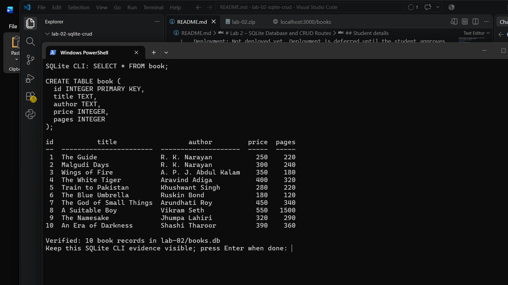

### SQLite CLI after CRUD requests

This genuine terminal screenshot shows the POST, PUT, and DELETE API requests succeeding, with a SQLite CLI query after each change. The final count confirms the database is back to its original ten seeded books.

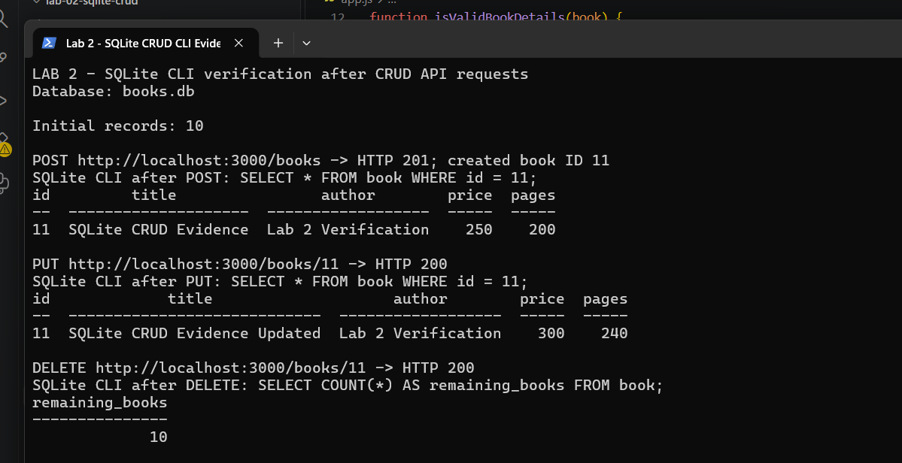

## Run the application

```sh
npm start
```

For development with automatic restart:

```sh
npm run dev
```

The server uses port `3000` by default. To use another port, set the `PORT` environment variable before starting the application.

## Deploy to Vercel

When importing `durisetivarshini-ux/varshini-duriseti-lab2-bdf` into Vercel, set **Root Directory** to `lab-02`. Vercel can then detect the Express app in `app.js`. The `vercel.json` configuration includes `books.db` in the function bundle. `sqlite3` is pinned to version 5.1.7 because the newer native binary required a glibc version that the Vercel runtime does not provide. The app exports the Express application for Vercel and still starts normally with `npm start` locally. Open the deployed root URL for the API message, or add `/books` to view the seeded records.

Vercel's function filesystem is temporary. The app copies the submitted `books.db` to `/tmp` so SQLite can open it in a function, but changes made by POST, PUT, or DELETE may disappear when the function instance is replaced and are not guaranteed to be shared between instances. Use a hosted database instead of this SQLite file if deployed data must persist.

## API endpoints

All responses use JSON. The `:bookId` path parameter is the integer ID of a book.

| Method | Endpoint | Description | Expected status |
|---|---|---|---|
| GET | `/` | Show the API welcome message | 200 |
| GET | `/books` | Return all books | 200 |
| GET | `/books/:bookId` | Return one book, or a not-found error | 200 / 404 |
| POST | `/books` | Add a book | 201; 400 for invalid details |
| PUT | `/books/:bookId` | Update a book | 200; 400 for invalid details; 404 if absent |
| DELETE | `/books/:bookId` | Delete a book | 200; 404 if absent |

### Available API screenshots

These are actual browser screenshots from requests sent to the running local API. They are **not Postman screenshots**.

**GET `/books` — all ten seeded books (HTTP 200):**

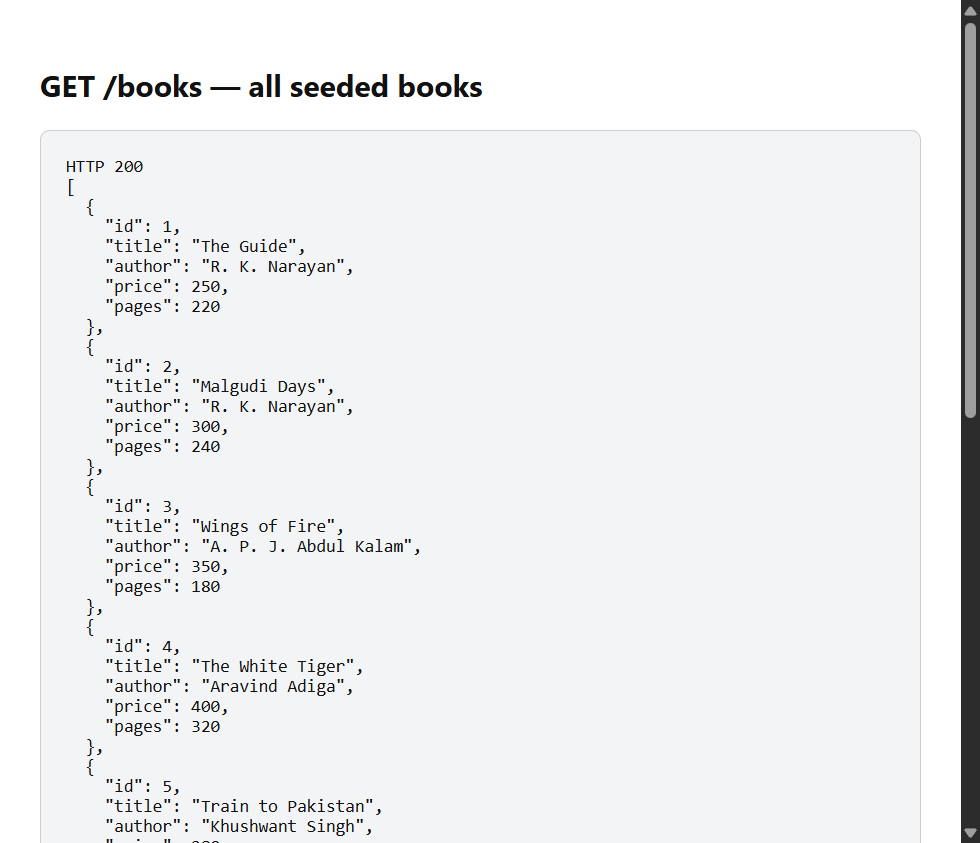

**GET `/books/1` — one book (HTTP 200):**

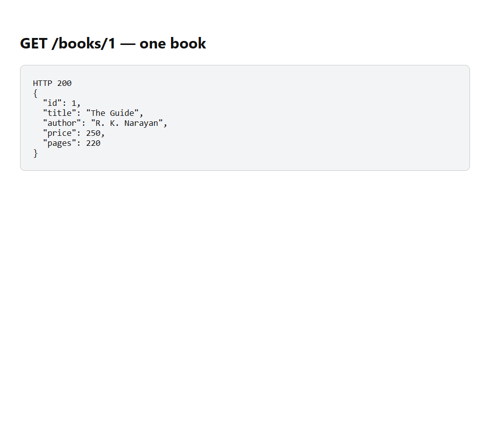

**POST `/books` — create a book (HTTP 201):**

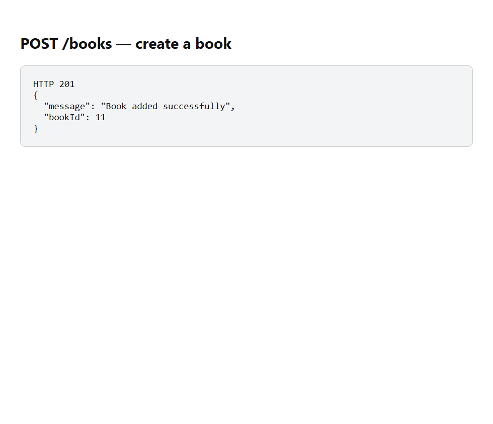

**GET `/books/11` — verify the inserted book (HTTP 200):**

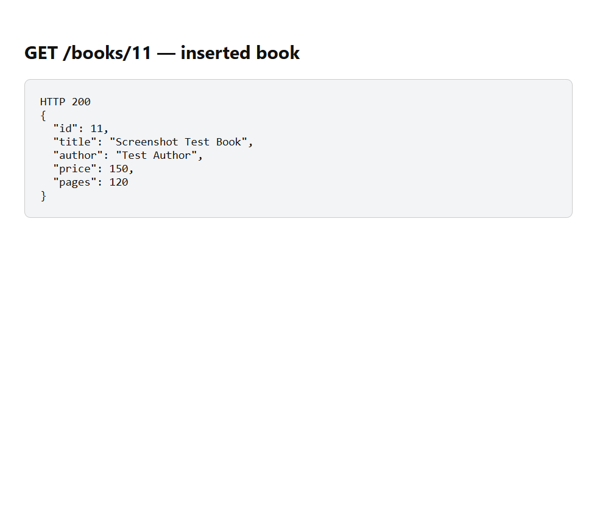

**PUT `/books/11` — update the book (HTTP 200):**

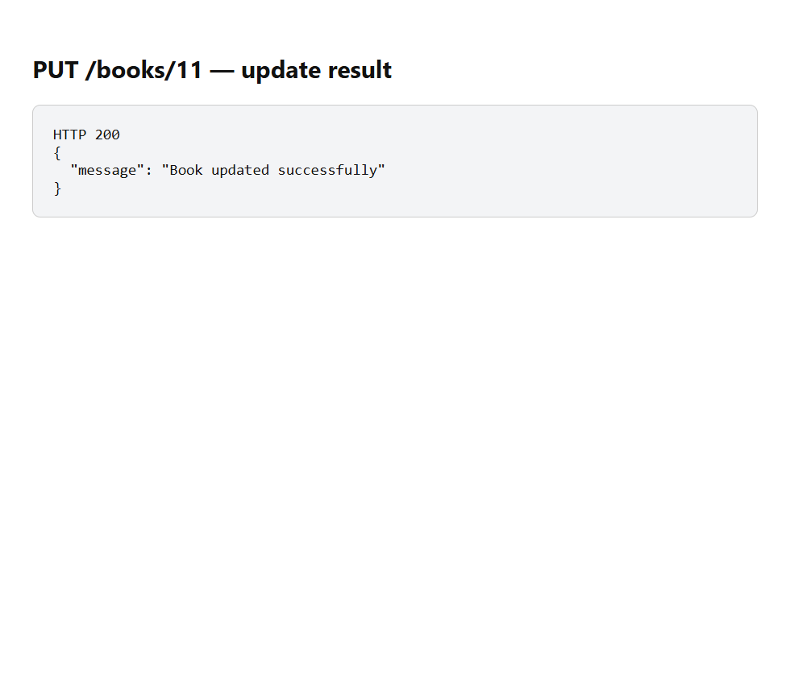

**GET `/books/11` — verify updated values (HTTP 200):**

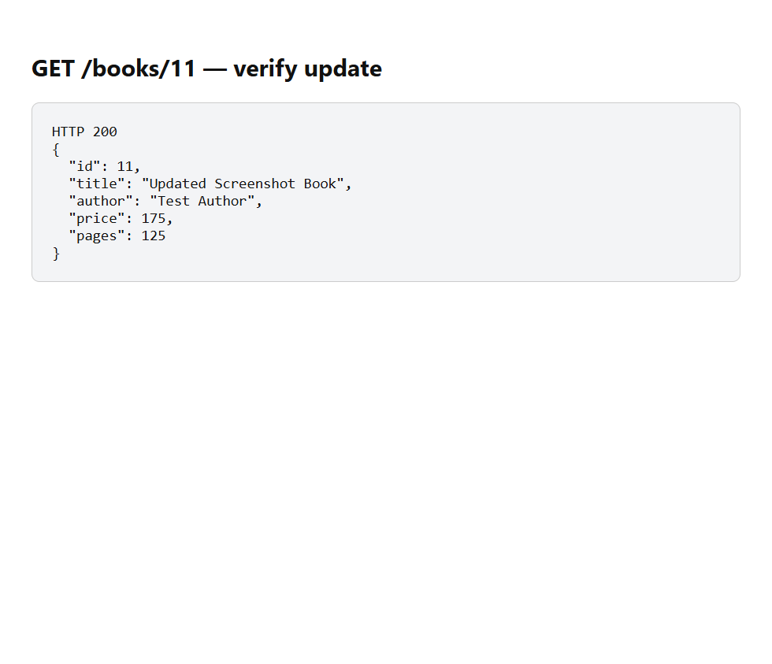

**DELETE `/books/11` — delete the book (HTTP 200):**

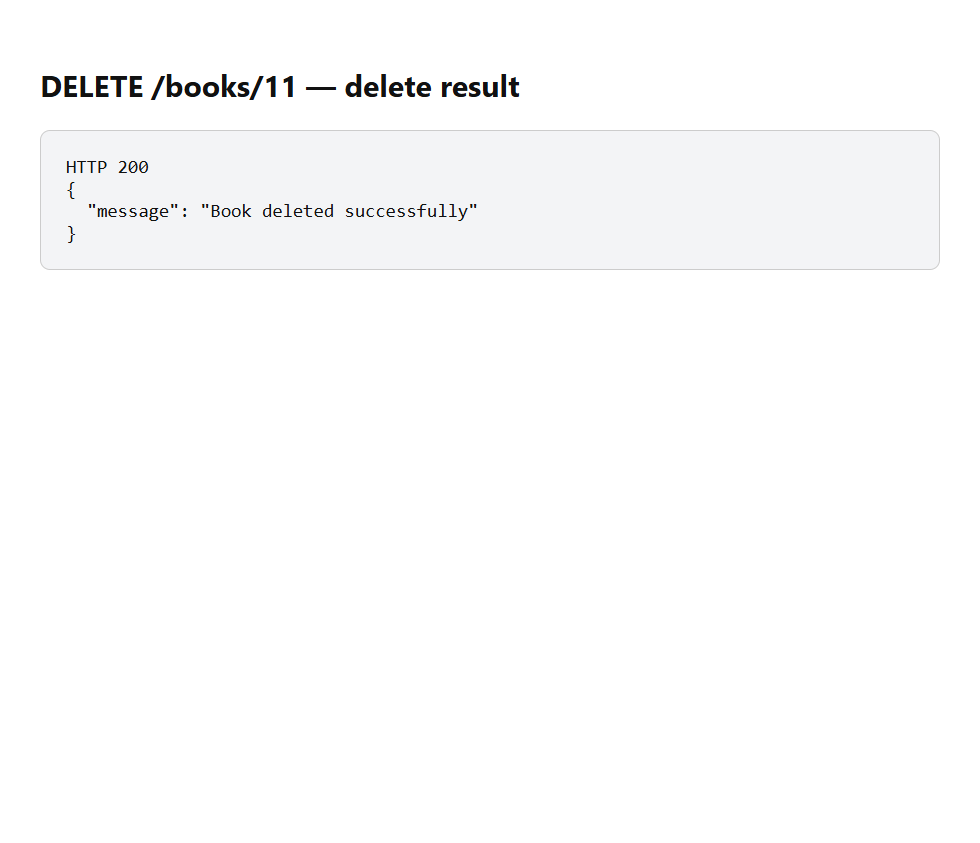

**GET `/books/11` — verify it was deleted (HTTP 404):**

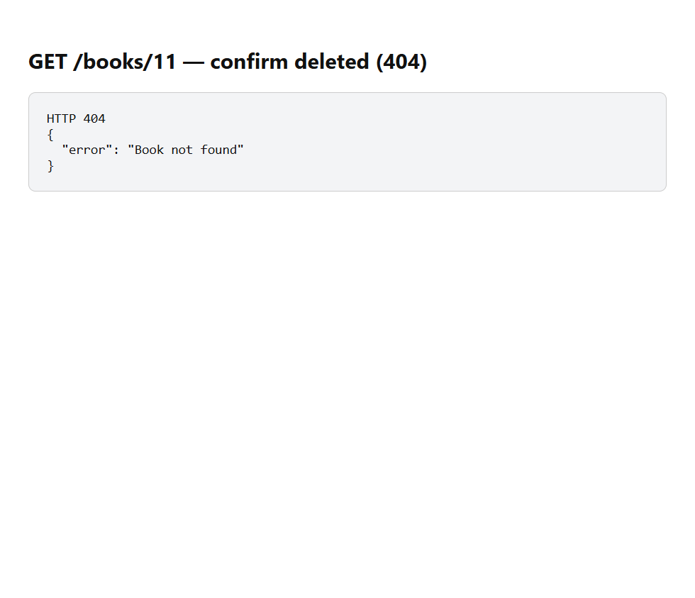

**GET `/books/999999` — missing book (HTTP 404):**

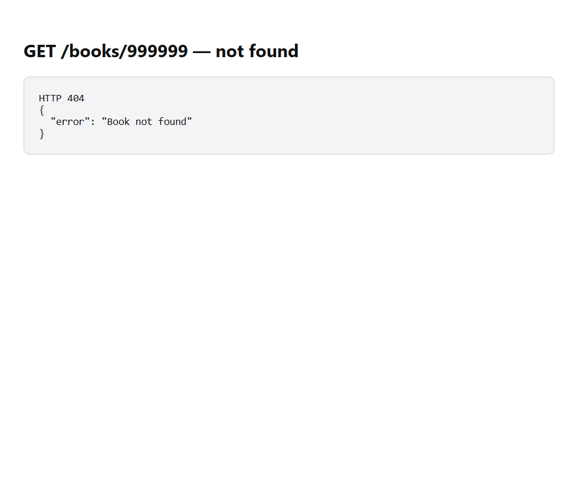

For POST and PUT, send JSON with `title`, `author`, `price`, and `pages`. Titles and authors must not be empty; `price` must be a non-negative integer and `pages` a positive integer. Route SQL values are passed using `?` placeholders rather than combined into SQL strings.

Example request body:

```json
{
  "title": "Sample Book",
  "author": "Sample Author",
  "price": 250,
  "pages": 200
}
```

## Testing and evidence

The app was started locally and its API routes were verified using browser/HTTP requests (not Postman): GET all (200), GET by ID (200), POST (201), PUT (200), DELETE (200), missing/deleted IDs (404), invalid details (400), malformed JSON (400), and a SQL-looking ID. The inserted/updated values were fetched back, deletion was checked, and the final database was confirmed to contain only its ten seed records using the Node.js `sqlite` driver. The seed SQL was also applied again and left the same ten records.

### Browser API screenshots

The browser response screenshots are shown in [Available API screenshots](#available-api-screenshots). They are browser evidence, not Postman evidence.

### Postman evidence

Postman is installed and the existing project collection/environment are prepared. These screenshots are captured from the actual Postman desktop app and are kept separate from the browser screenshots above. GET all and GET by ID have been run and captured. POST, PUT, and DELETE Postman runs/screenshots remain pending. Since the app is not deployed, the assignment's requirement for Postman evidence of every endpoint is not yet satisfied.

**GET `/books` — Postman, HTTP 200, ten books returned:**

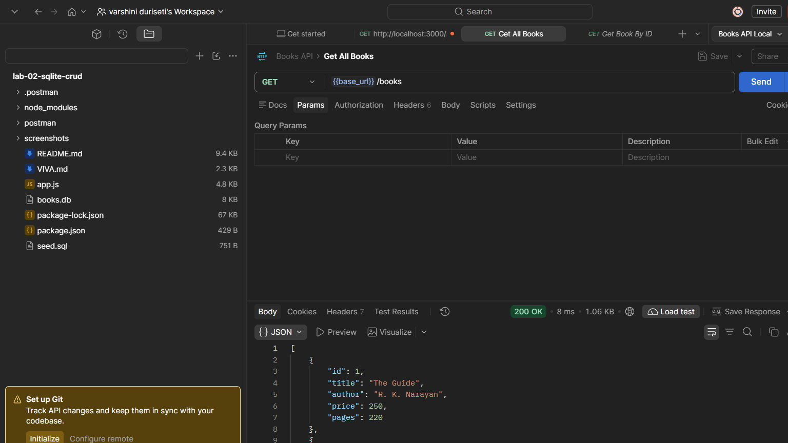

**GET `/books/1` — Postman, HTTP 200:**

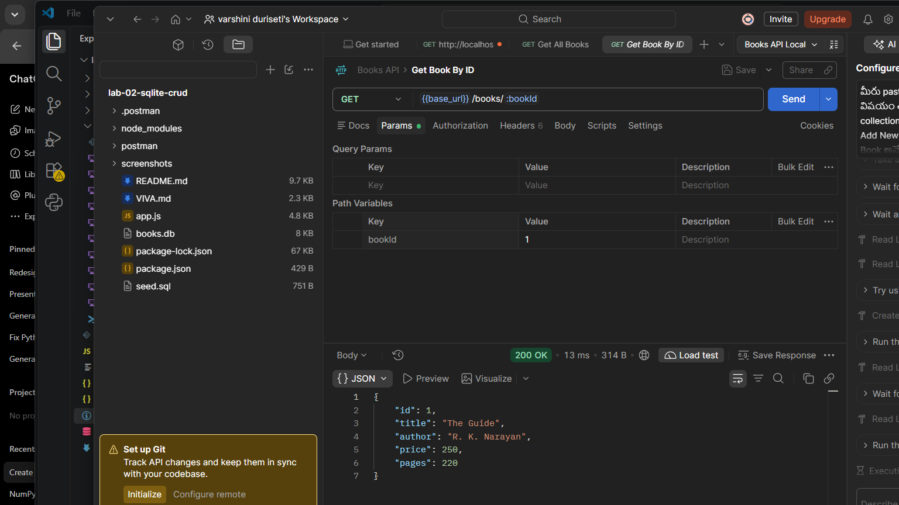

The table below tracks the Postman screenshots. Rows marked **Captured** are complete; the other screenshots are still missing. For each missing request, capture the Postman window with method, resolved URL, status, and response body visible. Save the image under the listed name in `screenshots/` and add it here below the matching request. Do not substitute browser response images.

| Screenshot filename | Postman request | Expected result |
|---|---|---|
| Captured: `12-postman-get-all.png` | `GET http://localhost:3000/books/` | 200; list of 10 books |
| Captured: `13-postman-get-by-id.png` | `GET http://localhost:3000/books/1` | 200; The Guide |
| `14-postman-post.png` | `POST http://localhost:3000/books/` | 201; new book ID in response |
| `15-postman-get-created.png` | `GET http://localhost:3000/books/{newBookId}` | 200; created book |
| `16-postman-put.png` | `PUT http://localhost:3000/books/{newBookId}` | 200; update success |
| `17-postman-get-updated.png` | `GET http://localhost:3000/books/{newBookId}` | 200; changed values |
| `18-postman-delete.png` | `DELETE http://localhost:3000/books/{newBookId}` | 200; delete success |
| `19-postman-get-deleted.png` | `GET http://localhost:3000/books/{newBookId}` | 404; book not found |
| `20-postman-invalid-id.png` | `GET http://localhost:3000/books/999999` | 404; book not found |

For POST, select **Body → raw → JSON** and send:

```json
{
  "title": "Postman Test Book",
  "author": "Test Author",
  "price": 150,
  "pages": 120
}
```

Copy the `bookId` from the 201 response and use it in the GET/PUT/DELETE URLs above. For PUT, use **Body → raw → JSON** with the same fields but change the title (for example, `Updated Postman Test Book`) and verify the changed response with GET before deleting it. Keep the final 404 screenshot after DELETE as proof the temporary test book was removed.

The GET-all and GET-by-ID entries are complete and their image files have been checked. The other Postman entries remain pending until their actual screenshots are saved and verified.

Install the SQLite command-line tools from [sqlite.org/download.html](https://www.sqlite.org/download.html), extract them, and add their folder to `PATH`. Open the project folder in a terminal and use the following commands to inspect the schema and records:

Postman requests to run against `http://localhost:3000`:

1. `GET /books`
2. `GET /books/1`
3. `POST /books` with the example JSON body above
4. `GET /books/{newBookId}` to verify the inserted book
5. `PUT /books/{newBookId}` with updated JSON and then GET it again
6. `DELETE /books/{newBookId}` and then GET it to confirm a 404
7. Try an invalid ID such as `/books/999999` and verify the 404 response

In a terminal opened in this project folder, capture the SQLite CLI evidence with:

```sh
sqlite3 books.db ".schema book"
sqlite3 books.db "SELECT * FROM book ORDER BY id;"
```

## Problems faced and solutions

- Postman evidence is separate from browser API evidence. The GET-all and GET-by-ID screenshots are saved; capture the remaining requests listed above before submission.
- The SQLite CLI was downloaded from the official SQLite site and used to verify the schema, initial rows, and database changes after POST, PUT, and DELETE.
- The faculty name differs between the supplied details and screenshot header. Confirm it before final submission.

## Conclusion

This lab project demonstrates the four CRUD operations with Express and SQLite. Database values supplied to SQL queries use placeholders, and missing book IDs return a 404 response.
